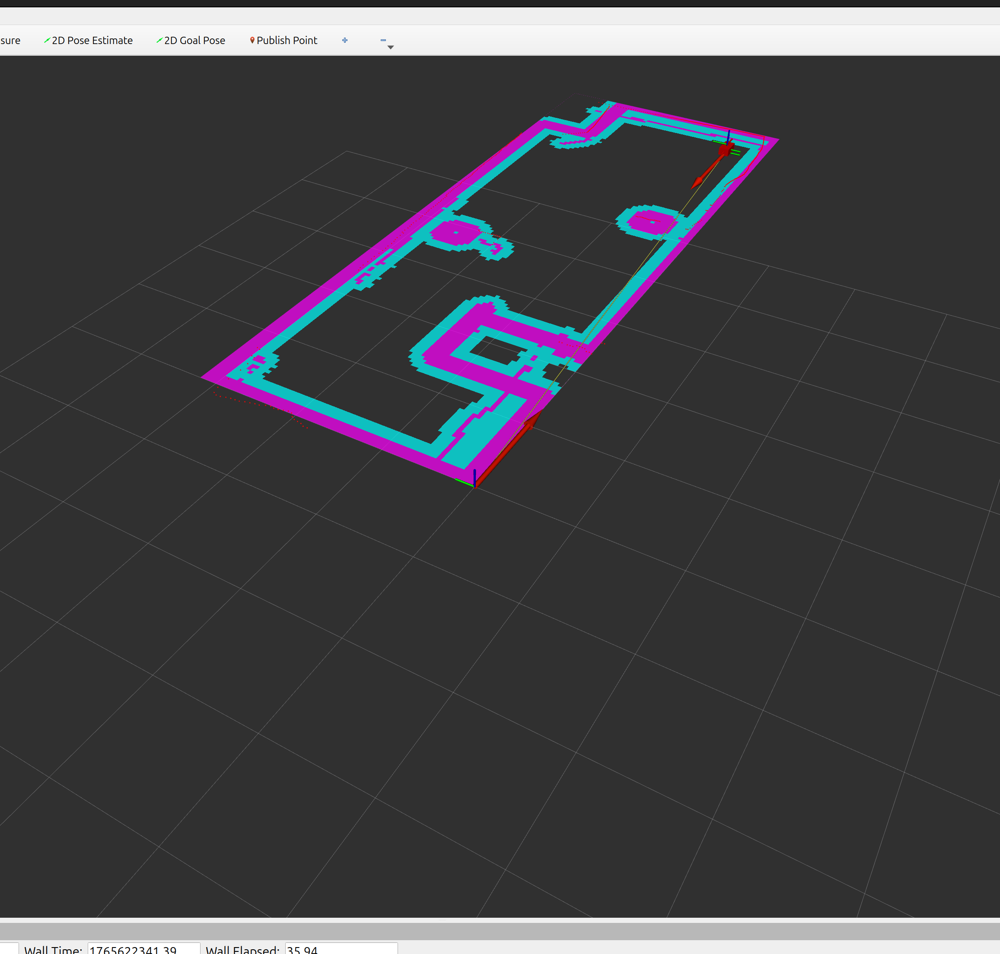
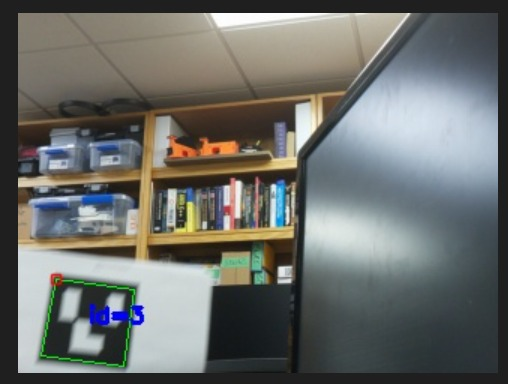
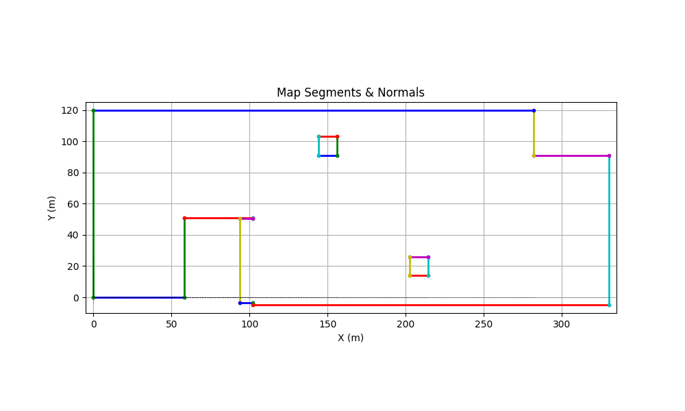

# Autonomous Indoor Inventory Verification (ROS 2 + Nav2 + ArUco)

A mobile robot that patrols a store-like aisle on its own, stops at each shelf bay, reads ArUco markers with a camera, and reports whether every product is in the bay where it belongs. Built with **ROS 2 Jazzy**, **Nav2 (AMCL)**, a 2D LiDAR and **OpenCV**.



**Demo video:** [`docs/head_to_goals.mp4`](docs/head_to_goals.mp4) · **Report:** [`docs/Autonomous_Indoor_Inventory_Verification.pdf`](docs/Autonomous_Indoor_Inventory_Verification.pdf)

---

### How it works

1. **Mapping and localization:** the area was mapped with the LiDAR (`map/map.yaml`), and Nav2 localizes the robot on that map with AMCL.
2. **Waypoint patrol:** `nav2_test` (Nav2 Simple Commander) sets the initial pose, drives the robot through a list of bay waypoints, and pauses at each one for a scan.
3. **Marker detection:** `detect_aruco` finds ArUco markers in the camera stream and publishes the visible IDs on `/aruco_ids`.
4. **Verification and logging:** `aruco_logger` uses bay markers to know where the robot is, checks each product marker against its expected bay from `config/aruco_ids.yaml`, and writes every result (`CORRECT` or `WRONG (found in X, expected Y)`) to a CSV audit report.

| ArUco detection | Map used by Nav2 |
| :---: | :---: |
|  |  |

### Repository structure

```
src/
├── pibot_bringup/            # robot side (package: omar_project)
│   ├── launch/launch_everything.launch.py   # LiDAR, robot_state_publisher, Nav2, RViz, mission node
│   ├── autonomous_indoor/nav2_test.py       # waypoint patrol with Nav2 Simple Commander
│   ├── config/nav2_params.yaml              # tuned Nav2 / AMCL parameters
│   ├── map/                                 # saved occupancy-grid map
│   └── urdf/                                # robot description for TF
└── camera_bringup/           # perception side (package: inventory_verification)
    ├── inventory_verification/detect_aruco.py   # OpenCV ArUco detection -> /aruco_ids
    ├── inventory_verification/aruco_logger.py   # bay/product verification + CSV report
    └── config/aruco_ids.yaml                    # product IDs, bay IDs, expected bay per product
```

### Run

```bash
cd ~/ros2_ws && colcon build && source install/setup.bash
ros2 launch omar_project launch_everything.launch.py      # LiDAR, TF, Nav2, RViz, waypoint patrol
ros2 run inventory_verification detect_aruco              # camera + marker detection
ros2 run inventory_verification aruco_logger              # verification + CSV report
```

### Tech stack
ROS 2 Jazzy · Nav2 (AMCL, Simple Commander) · RPLIDAR (`sllidar_ros2`) · robot_state_publisher / URDF · OpenCV ArUco · Python

### License
MIT
